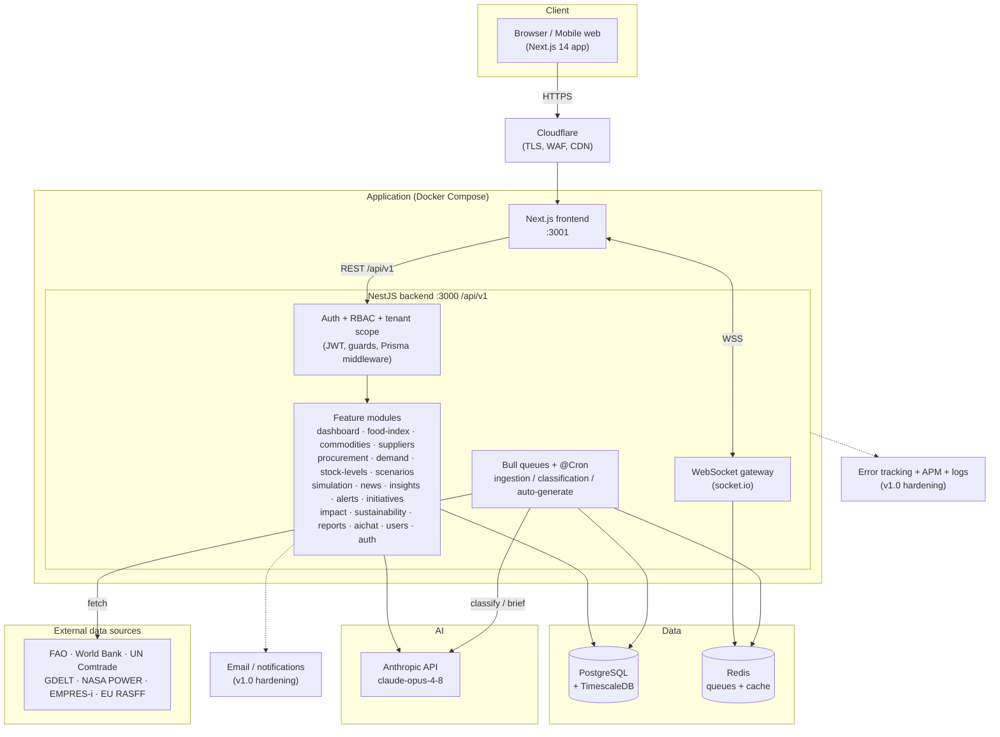
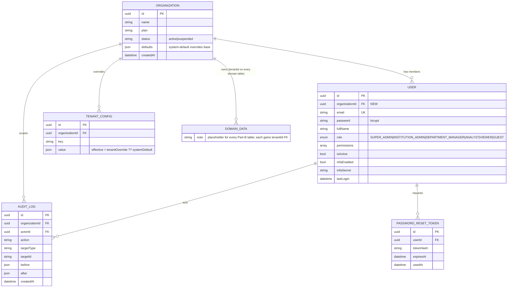

# Nexagon — System Architecture & Data Model

Grounded in the real codebase (`backend/package.json`, `backend/prisma/schema.prisma`) as of
2026-09-30. Diagrams are Mermaid (render on GitHub / most viewers). Two states are shown where
they differ: **current (v0.9 POC)** vs **v1.0 target** (adds multi-tenancy, audit, hardening).

## Tech stack (confirmed)

| Layer | Technology | Purpose |
|---|---|---|
| Frontend | **Next.js 14** (app router), **React 18** | SPA/SSR UI, 19 pages |
| | Tailwind CSS, Radix UI, `class-variance-authority` | styling + accessible primitives |
| | **Zustand** | client state (e.g. theme) |
| Backend | **NestJS 10** (Node) | modular REST API under `/api/v1` (URI versioning) |
| | **Prisma ORM** | data access + migrations |
| | `@nestjs/swagger` | API docs |
| | `@nestjs/websockets` + `platform-socket.io` | real-time push |
| | `@nestjs/schedule` | `@Cron` self-running pipelines |
| | **Bull** + `ioredis` + `@bull-board` | background jobs / ingestion queues + queue dashboard |
| | `@nestjs/jwt` + `passport-jwt` + `bcryptjs` | JWT auth, hashed passwords (MFA fields already in schema) |
| | `helmet`, `compression`, `class-validator` | security headers, gzip, DTO validation |
| | **`@anthropic-ai/sdk`** (`claude-opus-4-8`) | copilot, news classification, NL what-if, briefs |
| | `xlsx`, `adm-zip` | ingest World Bank Pink Sheet / zipped sources |
| Data | **PostgreSQL** (+ TimescaleDB extension for time-series) | primary store |
| | **Redis** | Bull queues + cache |
| Infra | **Docker Compose**, **Cloudflare** (TLS), VPS | packaging + deploy (prod build is a v1.0 gate) |
| External | FAO/FAOSTAT, World Bank, UN Comtrade, GDELT, NASA POWER, FAO EMPRES-i, EU RASFF | data feeds |

> **v1.0 additions to the stack:** an email/notification provider (Epic 19), error-tracking +
> APM (Epic 20), and a secrets manager (Epic 21). No framework changes — all fit the current stack.

## System architecture (v1.0 target)

## The decision loop (data flow)
Detect → Measure → Anticipate → Decide → Stress-test → Track → (feeds back to Measure). Scheduled
Bull/`@Cron` jobs pull external feeds, Claude classifies news + generates briefs, services compute
the index / forecasts / procurement calls, and completed initiatives change the data so the next
index recompute reflects them. Full narrative: `the-loop.md`.

## ERD — Part A: Identity, Tenancy & Audit (v1.0 target — NEW)
The POC is single-tenant. v1.0 introduces `Organization`, a `tenantId` FK on every domain table,
`AuditLog`, and password-reset support. (MFA fields `mfaEnabled`/`mfaSecret` already exist on `User`.)

## ERD — Part B: Domain model (current schema + v1.0 tenancy note)
20 models today. **Design reality:** relationships are mostly *soft* — tables reference a
`commodity` **string** (matching `Commodity.name`) or a `countryCode`, not hard FKs. The rebuild
should formalize the hot ones as real FKs and add `tenantId` (→ `ORGANIZATION`) to every table.
Full columns live in `schema.prisma`; key fields shown.

```mermaid
erDiagram
  COMMODITY ||..o{ COMMODITY_PRICE : "by name (soft)"
  COMMODITY ||..o{ STOCK_LEVEL : "by name (soft)"
  COMMODITY ||..o{ SELF_SUFFICIENCY : "by name (soft)"
  COMMODITY ||..o{ DEMAND_BASELINE : "by name (soft)"
  COMMODITY ||..o{ PROCUREMENT_RECOMMENDATION : "by name (soft)"
  COMMODITY ||..o{ NEWS_SIGNAL : "classified to (soft)"
  DATA_SOURCE ||..o{ COMMODITY_PRICE : "ingested from"
  NEWS_SIGNAL ||--o| NEWS_BRIEF : "summarized in"
  INDEX_INDICATOR }o..|| INDEX_SNAPSHOT : "rolls up to"
  SCENARIO ||..o{ INITIATIVE : "may spawn (soft)"
  PROCUREMENT_RECOMMENDATION ||--o| PROCUREMENT_BRIEF : "summarized in"

  COMMODITY {
    uuid id PK
    string name UK
    string category
    string faoItemCode
    string wbColumn
    string hsCode
    bool showOnDashboard
  }
  COMMODITY_PRICE {
    uuid id PK
    string commodity "soft FK"
    float priceUsd
    float priceSar
    float forecast30d
    float confidenceScore
    string source
    datetime recordedAt
  }
  SUPPLIER_COUNTRY {
    uuid id PK
    string countryCode UK
    array commodities
    float shareOfImports
    float riskScore
    int climateScore
    int diseaseEvents90d
    string exportPolicyStatus
    int transitTimeDays
  }
  STOCK_LEVEL {
    uuid id PK
    string commodity
    float currentStockMt
    int daysOfSupply
    string status
  }
  DEMAND_BASELINE {
    uuid id PK
    string commodity UK
    float annualConsumptionMt
    float annualProductionMt
    float annualImportsMt
  }
  SELF_SUFFICIENCY {
    uuid id PK
    string commodity UK
    float ksa
    float gcc
    float target
  }
  PROCUREMENT_RECOMMENDATION {
    uuid id PK
    string commodity UK
    string action "buy|hold|defer"
    int urgency
    int quantityMt
    json origins
    array reasoning
  }
  PROCUREMENT_BRIEF {
    uuid id PK
    string content "Claude markdown"
  }
  NEWS_SIGNAL {
    uuid id PK
    string url UK
    string commodity
    string country
    string eventType
    string severity
    int relevance
  }
  NEWS_BRIEF {
    uuid id PK
    string content
    int signalCount
  }
  INDEX_INDICATOR {
    uuid id PK
    string pillar
    string key UK
    float weight
    float score
  }
  INDEX_SNAPSHOT {
    uuid id PK
    float overall
    float availability
    float access
    float utilization
    float stability
  }
  SCENARIO {
    uuid id PK
    enum category
    enum severity
    array impactedCommodities
    json cascadingEffects
    string sourceKey UK
  }
  INITIATIVE {
    uuid id PK
    string status "proposed→…→completed"
    string priority
    string responsibleEntity
    string linkedCommodity
    string linkedPillar
    string sourceKey UK
  }
  ALERT {
    uuid id PK
    enum level "GREEN|AMBER|RED|BLACK"
    enum category
    bool isRead
    bool isAcknowledged
  }
  RISK_DOMAIN {
    int id PK
    string name
    float currentScore
    json indicators
  }
  DATA_SOURCE {
    uuid id PK
    string shortName
    enum category
    enum status "ACTIVE|WARNING|ERROR|DEGRADED"
    json config
  }
  APP_CONFIG {
    string key PK
    json value
  }
```

Standalone tables not drawn above (no domain relationships today): `AppConfig` (global key/value —
becomes per-tenant `TENANT_CONFIG` in v1.0), `NewsArticle` (labelled a "MongoDB mirror" in the
schema but currently a Postgres model).

## Design notes for the rebuild
- **Single-tenant → multi-tenant** is the biggest structural change: add `Organization`, a
  `tenantId` FK + index on every domain table, and enforce scoping centrally (Prisma middleware),
  not per query. See user-story epics 01 (tenancy), 02 (RBAC), 18 (admin consoles).
- **Soft string keys → FKs:** today `commodity` strings couple tables to `Commodity.name`.
  Formalize the hot paths as FKs during the rebuild to prevent orphaned/mismatched rows.
- **Roles:** the schema's `UserRole` enum (SUPER_ADMIN … GUEST) maps onto the story roles
  (Platform Admin / Org Admin / Analyst). Consolidate or map explicitly during the rebuild.
- **Time-series:** `commodity_prices`, `news_signals`, snapshots suit TimescaleDB hypertables
  (extension already noted in the schema header).
- **Jobs:** ingestion/classification/auto-generation run on Bull queues + `@Cron`; keep the
  self-healing "DEGRADED not crash" behavior (`ingestion.service.spec.ts`).
- **AI boundary:** all Claude calls go through the backend (never the browser); every AI feature
  degrades gracefully when `ANTHROPIC_API_KEY` is absent.
