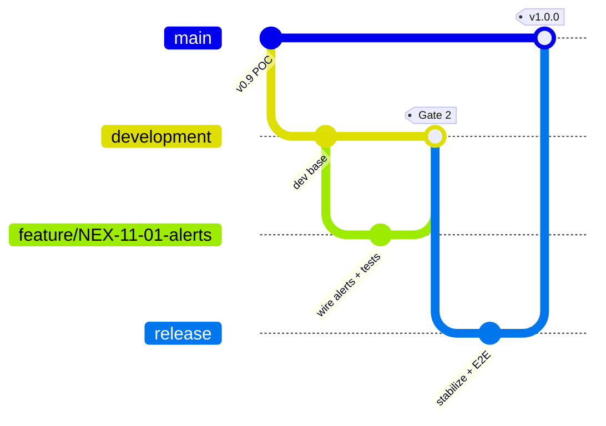

# Nexagon — Testing Strategy & Git Branching Model

How work flows through the repo and what must pass at each step. The guiding rule: **every user
story (`docs/user-stories/`) is backed by tagged, automated tests, and those tests gate the
merges.** Grounded in the stack (`architecture.md`): Jest (backend), Jest + React Testing Library
(frontend), Playwright (E2E), GitHub Actions (CI).

## The guarantee
- Every in-scope story `NEX-XX-YY` has **≥1 automated test tagged with its id**, derived from its
  Given/When/Then acceptance criteria.
- A story counts as **passed** only when its tagged tests are green.
- CI produces a **traceability report** (story → tests → pass/fail) and **fails if any in-scope
  story has no test or a failing one**. That's how "every story has passed" is enforced, not hoped.

## Git branching model
A trunk-with-release model matching your flow (feature → development → release → production).

| Branch | Purpose | Who writes | Protection |
|---|---|---|---|
| `main` | Production. Every commit is a tagged release (`vX.Y.Z`). | no direct commits | PR from `release`/`hotfix` only; all gates green |
| `release` | Pre-production stabilization + full E2E before go-live. | release manager | PR from `development`; Gate 3 required |
| `development` | Default integration branch; always deployable to the dev/staging env. | via PR only | PR from `feature/*`; Gate 2 required; no direct pushes |
| `feature/NEX-XX-YY-slug` | One story (or a small epic slice). Branch **off `development`**. | developer | — |
| `hotfix/NEX-XX-YY-slug` | Urgent production fix. Branch **off `main`**; merge to `main` **and** back to `development`/`release`. | developer | PR + gates |

**Conventions**
- Branch: `feature/NEX-11-01-wire-alerts-page`. One story per branch keeps the PR and its test
  scope small; bundle only tightly-coupled stories from the same epic.
- Commit (Conventional Commits + story id): `feat(alerts): wire alerts page to alertsApi [NEX-11-01]`.
- PR title carries the story id(s); PR description links the story and lists the AC covered.

## Test levels
| Level | Tooling | Scope | Speed |
|---|---|---|---|
| **Unit** | Jest (be), Jest+RTL (fe) | pure logic, services, components in isolation (mocks) | fast |
| **Integration** | Jest + supertest, ephemeral Postgres+Redis (docker/testcontainers) | API route → service → real DB; tenancy scoping, RBAC 403s, audit writes | medium |
| **Acceptance (story)** | Jest and/or Playwright, tagged `NEX-XX-YY` | one per story's AC — the pass/fail unit of the guarantee | mixed |
| **E2E** | Playwright | full user journeys across the running stack (login → act → verify) | slow |
| **Non-code verification** | checklist / ops drill | stories that can't be unit-tested (see below) | manual |

**Story → test tagging (traceability)**
- Jest: `describe('NEX-11-01 — view alerts', () => { ... })`
- Playwright: `test('[NEX-11-01] alerts render from API, org-scoped', { tag: '@NEX-11-01' }, ...)`
- A CI script scans `docs/user-stories/*.md` for all in-scope `NEX-XX-YY` ids and scans test files
  for the ids they cover, then emits a matrix and **fails the build** for any in-scope story with
  no passing test. (`ponytail:` simple regex scan of test titles is enough — no bespoke framework.)

**Cross-cutting tests that must exist per data story** (from the README global rules):
- **G1 tenancy:** an integration test proving org A cannot read/write org B's data (expect 404/403).
- **G5 audit:** every state-changing story asserts an audit entry is written.
- **G6 RBAC:** an Analyst token hitting an admin-only route gets 403.

## Knowing which layer failed (backend vs frontend)
A single full-stack test for a "general" story tells you it broke but not **where**. Fix: test
each layer in isolation so a failure localizes itself, and use E2E only for whole-journey
confidence — not diagnosis.

**Tag each story with the layer(s) it touches.** Add a `Layer:` marker to every story:
`Layer: backend` (e.g. NEX-03-06 recompute index), `Layer: frontend` (e.g. NEX-17-01 theme
switcher), or `Layer: both` (e.g. NEX-11-01 view alerts). This tells the developer how many tests
to write and lets the traceability report check per-layer coverage.

**A `both` story gets one test per layer, same story id:**
- **Backend test** — hit the real endpoint against a test DB (externals mocked): asserts response
  shape, org-scoping (G1), RBAC (G6), audit (G5). Fails → **backend bug**.
- **Frontend test** — render the component/page with the API client **mocked** to a fixture:
  asserts it renders rows / empty state / error state. Fails → **frontend bug**.
- **E2E (Playwright)** — the real journey through both. Fails while both layer tests pass →
  **integration** issue (wiring, contract mismatch, env), not logic.

**CI already localizes it:** backend and frontend run as **separate jobs** (see `github-setup.md`
— "Backend unit tests" vs "Frontend unit tests"). The red check name already tells you the layer
before you read a single log line. Tag the tests so it's unambiguous: `NEX-11-01` appears in a
`backend/` spec **and** a `frontend/` test; whichever job is red is the layer at fault.

**Diagnosis table**
| Backend layer test | Frontend layer test | E2E | Meaning |
|---|---|---|---|
| ❌ | — | — | Backend logic/API bug |
| ✅ | ❌ | — | Frontend rendering/logic bug |
| ✅ | ✅ | ❌ | Integration: contract drift, wiring, or env |
| ✅ | ✅ | ✅ | Story passes |

**Guard the contract (the sneaky gap):** the frontend mocks a fixture; if the real backend
response drifts from that fixture, both layer tests stay green but the app breaks — only E2E
catches it, late. Prevent it cheaply: define each response shape **once** (shared TS types or a
zod schema in a shared package), have the **backend integration test assert it emits that shape**
and the **frontend fixture be typed by it**. Then a backend change that breaks the contract fails
the backend test immediately — no full Pact setup needed. (`ponytail:` shared types + one schema
assertion, not a contract-testing framework.)

## The gates (tests mapped to branch transitions)
| Gate | Trigger | Must pass | Blocks |
|---|---|---|---|
| **Gate 1 — push** | every push to a `feature/*` branch | lint · typecheck (**zero `tsc` errors**) · `nest build` + `next build` · unit tests · the branch's story acceptance tests | fast feedback (non-blocking to others) |
| **Gate 2 — merge to `development`** | PR `feature/*` → `development` | Gate 1 + **integration tests** + **all AC tests for the story(ies) in the PR green** + traceability check (no untested in-scope story) + coverage threshold + 1 review approval | **merge to development** |
| **Gate 3 — promote to `release`** | PR `development` → `release` | **full regression** (all unit + integration + all story acceptance) + **full Playwright E2E** on a deployed staging stack + migration `deploy` + rollback rehearsal + staging smoke test | **cut to release** |
| **Gate 4 — production** | PR `release` → `main` | deploy from `release` · production smoke test · tag `vX.Y.Z` | **go-live** |

This is exactly your flow: story tests gate the feature→development merge; **E2E runs at
development→release**. Note we deliberately do **not** run the full E2E suite on every feature
push (too slow) — Gate 1/2 run the fast, relevant tests; Gate 3 runs everything.

## CI/CD (GitHub Actions)
- **On push to `feature/*` / PR opened:** Gate 1 job (lint, typecheck, build, unit, changed story tests).
- **On PR → `development`:** Gate 2 job (spin up Postgres+Redis services, run integration +
  acceptance, traceability report as a PR comment, coverage gate). Branch protection requires it.
- **On PR → `release`:** Gate 3 job (deploy to staging, run full regression + Playwright E2E,
  migration + rollback check). Branch protection requires it.
- **On merge to `main`:** build+push images, deploy prod, smoke test, create the `vX.Y.Z` tag/release.
- **Nightly (optional):** full E2E + dependency/vuln scan (NEX-21-04) against `development`.

## Test environments & data
- **Unit:** no external deps (mock Prisma/Anthropic).
- **Integration/E2E:** ephemeral Postgres + Redis (CI service containers or testcontainers); seed
  with a fixture that creates **≥2 orgs + users of each role** so tenancy/RBAC are actually exercised.
- **AI:** stub the Anthropic client in tests (assert tool-use orchestration + graceful no-key path,
  NEX-10-04) — don't call the live API in CI.
- Every test is isolated and idempotent (recall the POC seed had no idempotency guard) — reset
  state between runs.

## Non-code / hardening stories (can't be unit-tested)
Some stories (esp. epics 19–21) verify by drill or checklist, gated at **Gate 3/4**, tracked in a
per-release checklist:
- **Backups/DR (NEX-20-01):** a restore drill is performed and signed off before a release.
- **Security review/pen test (NEX-21-01):** completed with criticals remediated before go-live.
- **Accessibility (NEX-21-06):** automated axe scan in CI **plus** a manual screen-reader pass.
- **Error tracking/APM, data residency:** verified present in the staging/prod environment.
Mark these in the story with `Verify: ops-drill | manual | e2e` so the traceability report doesn't
demand a unit test for them.

## Definition of Done (merge checklist) — extends `user-stories/README.md`
- [ ] Story AC met, tests tagged `NEX-XX-YY` and green
- [ ] Tenancy (G1), audit (G5), RBAC (G6) covered where applicable
- [ ] No mock data / faked auth (G3); zero `tsc` errors; builds clean
- [ ] Integration test for any new API + DB path
- [ ] Coverage threshold met; PR reviewed
- [ ] Traceability report shows the story as covered

## What to set up now (v1.0 groundwork)
1. Fix the 2 `tsc` errors so `nest build` is CI-gateable (NEX-16-01).
2. Add the **frontend test harness** (Jest + RTL) — backend Jest already works.
3. Add **Playwright** for E2E.
4. Add the **GitHub Actions** workflows for Gates 1–4 + branch protection on `development`,
   `release`, `main`.
5. Add the **traceability script** (story-id ↔ test scan) and wire it into Gate 2.
